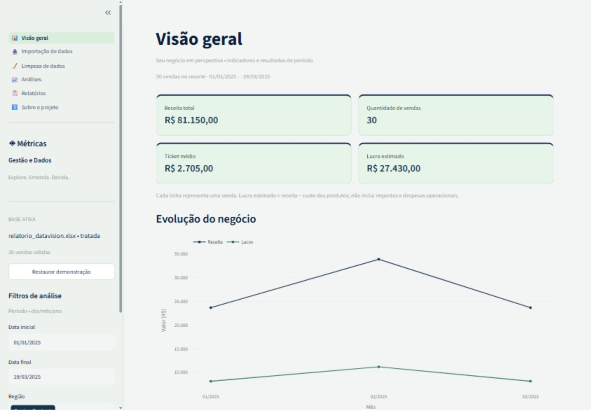
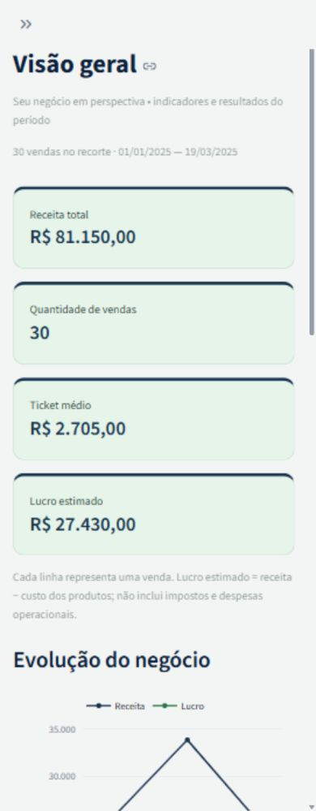

# ◈ Métricas Gestão e Dados

Plataforma de análise de vendas em português brasileiro para importar, tratar e transformar dados em indicadores de gestão. Projeto de portfólio em análise de dados. Importação, ETL, indicadores, visualização interativa e relatórios em uma versão pública estática para GitHub Pages. A versão Python/Streamlit também está disponível para execução local.

## Acesso online

Aplicação pública: https://gabmali.github.io/metricas-gestao-e-dados/

A versão online funciona sem login e sem instalação, inclusive no celular. As planilhas são processadas em memória no navegador; não são enviadas ao servidor. Recarregar a página descarta os dados importados. Exporte os resultados antes de sair.

## Versão GitHub Pages

O diretório `web/` contém HTML, CSS e JavaScript, com Plotly e SheetJS incluídos localmente. Os seis módulos mantêm importação CSV/XLSX com seleção de aba e mapeamento, limpeza com edição e validação, filtros, gráficos e exportações Excel/CSV.

Para executar localmente:

```bash
python -m http.server 8503 --directory web
```

Abra http://localhost:8503. Para testar o núcleo da versão online com Node.js 20 ou mais recente:

```bash
node --test web/core.test.cjs
```

O workflow `.github/workflows/pages.yml` testa e publica `web/` no GitHub Pages a cada push para `main`. A navegação usa fragmentos (`#analises`, `#relatorios`), compatíveis com a hospedagem estática.

## Funcionalidades

- **Visão geral:** receita, vendas, ticket médio, lucro estimado, evolução mensal, categorias e ranking de produtos.
- **Importação:** CSV e XLSX até 20 MB, seleção de aba, prévia e mapeamento de oito campos obrigatórios.
- **Limpeza:** diagnóstico de nulos, tipos e duplicatas; conversão de datas e números; edição de células; prévia e exportação da cópia tratada.
- **Análises:** linhas, barras, rosca, dispersão, Top 10, consolidação regional e comparação mensal.
- **Relatórios:** indicadores, consolidados, observações por regras matemáticas e exportação Excel com múltiplas abas ou CSV por tabela.
- **Sobre:** conceitos, ETL, tecnologias, instruções e competências demonstradas.

Filtros por período, região e categoria atualizam os indicadores, gráficos e relatórios. Uma seleção vazia produz um recorte vazio. Cada página analítica mantém seus próprios controles de filtro.

Os filtros de data usam DD/MM/AAAA. Os cartões se reorganizam em telas estreitas, os gráficos se empilham e as tabelas permitem rolagem interna. O resultado da revisão de QA está em [docs/VALIDACAO.md](docs/VALIDACAO.md).

Paleta visual: verde claro `#E6F4EA` nos cartões, cinza claro `#F3F5F4` no fundo e azul escuro `#17324D` em títulos, valores e botões. Os gráficos combinam azul escuro e verdes com contraste mais forte para as séries.

## Tecnologias

Python **3.11+** (validar preferencialmente em 3.12), Streamlit, Pandas, NumPy, Plotly, OpenPyXL, Pytest e Git. GitHub Actions executa a suíte em Python 3.11 e 3.12. Nenhuma credencial é necessária.

## Instalação e execução da versão Python

Abra um terminal na pasta deste README. No Windows, use uma instalação Python 3.11 ou mais recente:

```powershell
py -3.12 -m venv .venv
.\.venv\Scripts\python.exe -m pip install -r requirements.txt
.\.venv\Scripts\python.exe -m streamlit run app.py
```

Se o ambiente virtual já estiver criado, basta o último comando. Acesse o endereço local informado pelo Streamlit, normalmente http://localhost:8501. Para interromper, pressione Ctrl+C no terminal.

Linux/macOS:

```bash
python3 -m venv .venv
source .venv/bin/activate
python -m pip install -r requirements.txt
streamlit run app.py
```

## Estrutura

```text
metricas-gestao-e-dados/
├── web/                        # aplicação pública estática
├── app.py
├── requirements.txt
├── requirements-lock.txt       # versões do ambiente validado
├── README.md
├── .gitignore
├── .streamlit/config.toml
├── .github/workflows/tests.yml
├── data/vendas_ficticias.csv
├── src/
│   ├── data_loader.py
│   ├── data_cleaning.py
│   ├── analytics.py
│   ├── charts.py
│   ├── reports.py
│   ├── data_generator.py
│   ├── ui.py
│   └── overview.py
├── pages/
│   ├── 1_Importacao.py
│   ├── 2_Limpeza.py
│   ├── 3_Analises.py
│   ├── 4_Relatorios.py
│   └── 5_Sobre.py
└── tests/
    ├── test_analytics.py
    ├── test_cleaning.py
    ├── test_loader.py
    └── test_app.py
```

## Conjunto de dados e contrato de importação

A demonstração contém **2.400 vendas sintéticas**, oito produtos, duas categorias e cinco regiões brasileiras, distribuídas entre 2024 e 2025. Semente NumPy `42`; preços variam de acordo com o produto, custo representa 50% a 80% do preço, e quantidades variam de 1 a 8. Não contém dados pessoais. Para regenerar o CSV:

```bash
python -m src.data_generator
```

Campos obrigatórios: `ID da venda`, `Data`, `Produto`, `Categoria`, `Região`, `Quantidade`, `Preço unitário`, `Custo unitário`. Colunas com outros nomes podem ser mapeadas. Cada linha representa uma venda completa de um produto, com ID único; vendas com várias linhas por pedido devem ser previamente adaptadas a esse contrato.

Datas aceitas: ISO `AAAA-MM-DD` e brasileiras `DD/MM/AAAA`, além de células de data do Excel. Números: valores numéricos, decimal com ponto ou formato brasileiro `R$ 1.234,56`. Uma string `1.234` significa decimal com ponto; milhares devem usar `1.234,00`. Datas seriais numéricas sem formatação Excel são rejeitadas. CSV aceita UTF-8/UTF-8 BOM ou Windows-1252, com separador detectado automaticamente; prefira ponto e vírgula ao usar vírgula decimal.

Quantidade deve ser inteira e positiva; preços e custos devem ser finitos e não negativos. Nulos em campos obrigatórios, datas inválidas e IDs duplicados impedem ativação. Duplicatas completas podem ser removidas explicitamente; conflitos de ID precisam de revisão. Não há imputação automática de valores.

O original é preservado em memória e uma cópia mapeada é usada para limpeza. As colunas financeiras existentes no upload são substituídas explicitamente por cálculos de quantidade e valores unitários na base analítica. Colunas extras ficam no original, mas não integram o modelo analítico. A aplicação não persiste uploads em disco; recarregar ou encerrar a sessão pode perder alterações. Apenas o CSV fictício integra o repositório.

## Indicadores e critérios

| Indicador | Cálculo |
| --- | --- |
| Receita da venda | Quantidade × preço unitário, arredondado a 2 casas |
| Custo total | Quantidade × custo unitário, arredondado a 2 casas |
| Lucro estimado | Receita − custo total, arredondado a 2 casas |
| Receita total | Soma das receitas |
| Quantidade de vendas | Número de linhas com ID único |
| Ticket médio | Receita total / quantidade de vendas |
| Margem de lucro | Lucro / receita × 100 |
| Variação mensal | (Receita do mês / receita do mês anterior − 1) × 100 |

Recortes vazios exibem indicadores zero. Margem com receita zero e variação com base anterior zero ficam indisponíveis. Os meses sem vendas entre a primeira e a última venda observada recebem zero. A comparação usa os dois últimos meses presentes nessa série e pode incluir meses parciais conforme o filtro. Não se presume causalidade, significância estatística ou previsão. Lucro não inclui impostos, frete ou despesas operacionais. Usa-se ponto flutuante com arredondamento por venda; este é um projeto analítico, não um sistema contábil.

## Exportações

O arquivo `relatorio_metricas_gestao_e_dados.xlsx` inclui indicadores, mensal, categorias, regiões, produtos, observações, filtros e vendas. CSV exporta a tabela selecionada em UTF-8 BOM, delimitador `;` e vírgula decimal. Textos iniciados por caracteres de fórmula recebem apóstrofo na exportação para evitar interpretação como fórmula em planilhas.

## Testes

```powershell
.\.venv\Scripts\python.exe -m pytest
```

Com ambiente ativado: `python -m pytest`. A suíte verifica cálculos conhecidos, reprodutibilidade, filtros, totais agregados, casos vazios, base mensal zero, leitura CSV/XLSX, abas Excel, arquivos inválidos, limite de tamanho, mapeamento, limpeza sem mutação, rejeição de registros inválidos, exportações e renderização das seis páginas com Streamlit AppTest.

## Publicar no GitHub

Nome sugerido: **`metricas-gestao-e-dados`**.

Descrição do repositório:

> Plataforma de análise de vendas com importação de CSV e Excel, limpeza de dados, indicadores, gráficos interativos e exportação de relatórios. Desenvolvida com Python e Streamlit.

Crie um repositório vazio, sem README inicial, e envie **o conteúdo da pasta que contém `app.py` e este README** como raiz. Substitua `SEU_USUARIO` pelo seu usuário do GitHub. A pasta local pode manter seu nome atual.

```bash
git status --short
```

Para criar o primeiro commit e conectar o repositório:

```bash
git init -b main
git add .
git commit -m "Implementa Métricas Gestão e Dados"
git remote add origin https://github.com/SEU_USUARIO/metricas-gestao-e-dados.git
git push -u origin main
```

`.venv`, caches, arquivos de execução e segredos estão no `.gitignore`.

O workflow `.github/workflows/tests.yml` executa os testes a cada push e pull request em Python 3.11 e 3.12. A execução no GitHub poderá ser conferida na aba **Actions** após o primeiro envio.

## Capturas da aplicação

Interface atual com a marca Métricas Gestão e Dados:

### Computador



### Celular

Simulação de viewport com 390 pixels de largura.



## Validação local

- 36 testes aprovados na suíte completa após a mudança de nome.
- 11 testes de interface aprovados novamente, incluindo a marca nas seis páginas.
- Nenhuma dependência incompatível em `python -m pip check`.
- Detalhes e limitações de QA em [docs/VALIDACAO.md](docs/VALIDACAO.md).

## Licença

Este repositório ainda não possui licença de uso e distribuição definida.

## Limitações e melhorias futuras

- Processamento em memória, voltado a bases pequenas e médias; tamanho do arquivo não equivale ao uso de memória após leitura.
- Sem autenticação, armazenamento permanente ou controle de acesso multiusuário.
- Mapeamento analítico restrito ao contrato de vendas descrito acima.
- Melhorias futuras: comparação de períodos equivalentes, formatos regionais configuráveis, testes visuais, suporte a múltiplos itens por venda e exportação PDF.
